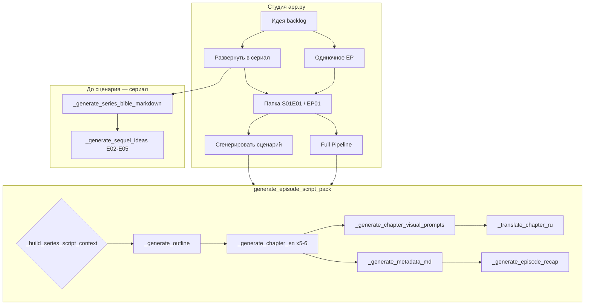

# Генерация сценариев: Standalone и сериал

Документ для продюсера и правки промптов. Описывает окна в Студии, цепочку LLM и точки входа в коде.

**Модель:** провайдер и модель из `config/ai_settings.json` (боковое меню **«Активные нейросети»**); вызовы идут через `scripts/ai_router.generate_text` (`cf_chat` в `studio_ai.py` — обёртка).

**Ядро сценария:** `generate_episode_script_pack(episode_dir)` в `scripts/studio_ai.py`.

---

## 1. Окна в Студии (до сценария)

Блок **«Эпизод и запуск»** в `app.py` → `page_studio`.

| Зона | Что делает | ИИ? |
|------|------------|-----|
| **Плейлист** | фильтр `standalone` или `S01`… | нет |
| **➕ Новый плейлист (Сериал)** | `playlists.json` + пачка тем + шаблон bible | да (`generate_series_backlog_ideas`) |
| **➕ Следующая серия (N+1)** | одна строка в backlog | да (`generate_next_series_episode`) |
| **📖 series_bible.md** | ручное редактирование | нет |
| **Папка эпизода** | фильтр по плейлисту, бейджи | нет |
| **Идея из бэклога** | две кнопки (см. ниже) | при развёртывании — да |
| **🔄 Превратить выпуск в Серию 1** | над конвейером, только standalone | да |

### Идеи в бэклоге (ещё не сценарий)

- **🎬 Создать одиночное видео (1 эпизод)** — папка `EP##_slug`, строка backlog с `Series_ID=standalone`, `Episode_Num=1`.
- **📚 Развернуть в многосерийный плейлист (Сериал)** — `expand_backlog_idea_to_series`:
  1. `create_playlist` → `playlists.json`
  2. `_generate_series_bible_markdown` → полный `series_bible.md`
  3. строка идеи → `S01E01`, в backlog темы **E02–E05** (`_generate_sequel_ideas`)
  4. папка `S01E01_*` (переименование с `EP01_*` или новая)

**Конвертация уже начатого EP** — тот же `expand_…`, в промпт bible до **15 000** символов из `script.md`.

> **Важно:** popover «Новый плейлист» вызывает `generate_series_backlog_ideas` — пачка **5 тем** и bible из **шаблона** (`templates/series_bible.md`), без «умной» генерации bible, как при «Развернуть».

---

## 2. Что запускает генерацию сценария

Один код, два входа в UI:

1. **Секция А** → **«✍️ Сгенерировать / Переписать сценарий через ИИ»** → фон: `scripts/generate_episode_pack.py`.
2. **«🚀 Полная генерация (Full Pipeline)»** → `scripts/run_full_pipeline.py`: если `script_needs_generation()` — тот же пакет, иначе шаг пропускается.

### Условие «нужен новый сценарий» (`script_needs_generation`)

- нет `script.md`, **или**
- слов меньше порога: `max(450, extra_chapter_floor - 150)` (для sleep ~2050 слов).

### Входы для пакета сценария (всегда)

- `channels/<slug>/channel_config.md` — в каждый user-промпт (обрезка 6–9k символов).
- **Topic / Topic_RU / Angle** из `backlog.csv` по ID папки (`_topic_for_episode`).
- **Standalone vs сериал** — по `Series_ID` в строке backlog (`_build_series_script_context`).

---

## 3. Standalone vs сериал при генерации сценария

Различие: строка **`series_context`**, вставляется в **outline** и **каждую главу EN**.

### Standalone (`Series_ID == standalone` или нет строки)

Константа **`STANDALONE_SCRIPT_RULES`**:

- одна законченная sleep-история;
- мягкий вход, **без** bible и клиффхэнгеров под продолжение.

Bible и Recap в промпт сценария **не** попадают.

### Сериал (`Series_ID == S01`…)

`_build_series_script_context` добавляет:

- инструкции: серийный выпуск, внешность героев как в bible, **напоминание прошлой серии только в главе 1**, без полного пересказа;
- до **14 000** символов `series_bible.md`;
- до **6 000** символов секции **## Recap**.

Путь bible: `channels/<slug>/playlists/S01_<slug>/series_bible.md`.

**После успешной записи файлов (только сериал):**

- `_generate_episode_recap` — 3–6 предложений;
- `append_recap_block` — блок `### S01E01 — Topic` в bible.

Редактирование bible в UI **до** генерации влияет на следующий прогон; **после** — дополняется Recap.

---

## 4. Пошагово: пакет сценария (`generate_episode_script_pack`)

| Шаг | Функция | Выход | Standalone / сериал |
|-----|---------|--------|----------------------|
| 0 | `script_profile(channel_slug)` | лимиты слов/глав | sleep (`channel_02*` / `sleep_history`): ~2300–2800 слов, 5×480–550; иначе gaming mystery |
| 1 | `_generate_outline` | JSON 5× `{title, beats}` | + `Format: {series_context}` |
| 2 | цикл по 5 главам | | |
| 2a | `_generate_chapter_en` | текст EN | + `Series / format: {series_context}` |
| 2b | `_generate_chapter_visual_prompts` | 4× `PROMPT:` (sleep) | **без** series_context — config + отрывок главы |
| 2c | `_translate_chapter_ru` | глава RU | без series_context |
| 3 | sleep-добивка объёма | | |
| | мало слов → глава 6 «Deeper night» | | с `series_context` |
| | иначе переписывается глава 5 с прощанием | | |
| 4 | `_generate_metadata_md` | `metadata.md` | excerpt сценария |
| 5 | (сериал) `_generate_episode_recap` | Recap в bible | отдельный короткий промпт |

**Файлы в папке эпизода:**

- `script.md` — `## Title` + главы EN
- `script_ru.md` — то же RU
- `visual_prompts.md` — до **25** промптов (минимум 20, иначе ошибка)
- `metadata.md`

**Проверки:** общий объём &lt; `word_target_min - 200` → отказ; слишком короткая глава → отказ.

---

## 5. Sleep-канал: глава 5 и 6

Для `sleep_style=True` в `_generate_chapter_en`:

- главы 1–4: **запрет** «good night»;
- прощание: доп. **глава 6** или **повторная генерация 5-й** с `allow_farewell=True`.

Для не-sleep — другие правила финала (открытый clue).

В outline всё ещё может быть `Style: Calm sleep history…` даже для магического канала — это в `_generate_outline` (`style`).

---

## 6. Где править промпты

| Задача | Файл | Место |
|--------|------|--------|
| Правила standalone в сценарии | `scripts/studio_ai.py` | `STANDALONE_SCRIPT_RULES` |
| Правила серии в сценарии | `scripts/studio_ai.py` | `_build_series_script_context` |
| План 5 глав | `scripts/studio_ai.py` | `_generate_outline` |
| Текст главы EN | `scripts/studio_ai.py` | `_generate_chapter_en` |
| PROMPT кадры | `scripts/studio_ai.py` | `_generate_chapter_visual_prompts` |
| RU-адаптация | `scripts/studio_ai.py` | `_translate_chapter_ru` |
| Metadata YouTube | `scripts/studio_ai.py` | `_generate_metadata_md` + `templates/episode_metadata.md` |
| Recap после выпуска | `scripts/studio_ai.py` | `_generate_episode_recap` |
| Bible при «Развернуть» | `scripts/studio_ai.py` | `_generate_series_bible_markdown` |
| Темы E02–E05 | `scripts/studio_ai.py` | `_generate_sequel_ideas` |
| 5 standalone-идей | `scripts/studio_ai.py` | `STANDALONE_IDEA_RULES`, `_idea_messages` |
| Пачка тем (popover) | `scripts/studio_ai.py` | `_series_messages` |
| Следующая серия в backlog | `scripts/studio_ai.py` | `_next_episode_messages` |
| Ниша, тон канала | `channels/<slug>/channel_config.md` | во все user-промпты |
| Шаблон bible | `templates/series_bible.md` | до ИИ / вручную |

**Замечание:** визуальные промпты для сериала **не** подмешивают bible явно — только через текст главы. Для жёсткого «visual lock» логично доработать `_generate_chapter_visual_prompts`.

---

## 7. Схема потока

---

## 8. Практические выводы

1. Одиночка и сериал при **написании одного выпуска** делят почти всю цепочку; развилка — `STANDALONE_SCRIPT_RULES` vs врезка bible в `series_context`.
2. Полноценная AI-bible появляется при **«Развернуть» / конвертации EP**, не при «Новом плейлисте» из popover.
3. Серии 2+ опираются на **актуальный Recap** после предыдущих выпусков.
4. Для магических каналов проверьте `channel_config.md` и `style` в `_generate_outline`.

---

*Обновляйте этот файл при смене логики в `studio_ai.py` или UI студии.*